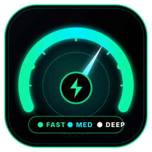
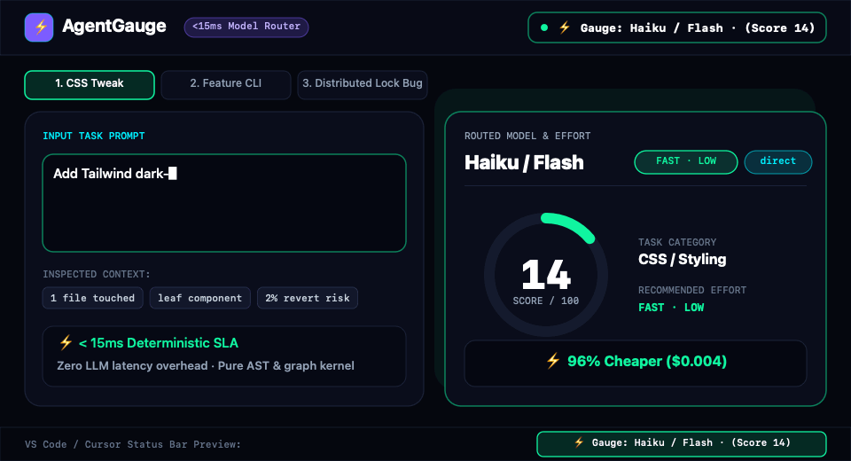

<p align="center">
  
</p>

<h1 align="center">⚡ AgentGauge (<code>agent-gauge</code>)</h1>

<p align="center">
  <strong>Stop burning Opus High on CSS edits. Stop under-powering distributed lock bugs.</strong>
</p>

**AgentGauge** is an open-source, deterministic `<15ms` Agent Skill, MCP Server, VS Code Status-Bar Extension, and Next.js 15 Telemetry Visualizer that routes coding tasks to the optimal **(Agent Execution Mode + Model Tier + Effort Level: Low / Medium / High)** and learns from real **git diff survival** outcomes.

<p align="center">
  <a href="https://haripriyarao26.github.io/agent-gauge/"><strong>🚀 Launch Live Interactive Playground &amp; 3D Telemetry Demo (GitHub Pages) →</strong></a>
  &nbsp;&middot;&nbsp;
  <a href="./.github/workflows/deploy-pages.yml"><code>.github/workflows/deploy-pages.yml</code></a>
</p>

<p align="center">
  <a href="https://haripriyarao26.github.io/agent-gauge/">
    
  </a>
</p>
<p align="center">
  <sub><strong>Live 12s Walkthrough:</strong> Watching the <code>&lt;15ms</code> 4-dimension scorer &amp; VS Code status bar pill (<code>⚡ Gauge: Sonnet · Med (Score 48)</code>) flip from <strong>Haiku/Flash Low (Score 14)</strong> for a CSS tweak to <strong>Opus/Pro High (Score 92 · plan-first)</strong> for a distributed Redis lock &amp; Postgres billing race bug.</sub>
</p>

---

## 4 Distribution Channels from 1 Monorepo

1. **`skills.sh` Multi-Agent Skill:**
   ```bash
   npx skills add haripriyarao26/agent-gauge
   ```
   Powered by root [`SKILL.md`](./SKILL.md) + [`agents/router-agent.md`](./agents/router-agent.md), [`agents/calibration-agent.md`](./agents/calibration-agent.md), and [`agents/report-agent.md`](./agents/report-agent.md).

2. **MCP Server & CLI (`packages/mcp-server`):**
   ```bash
   npx agent-gauge score "Fix Postgres billing race condition" --files src/ledger.ts
   npx agent-gauge report --out report.json
   ```
   Or add to `~/.cursor/mcp.json` / `claude_desktop_config.json`:
   ```json
   {
     "mcpServers": {
       "agent-gauge": {
         "command": "npx",
         "args": ["-y", "agent-gauge-mcp"]
       }
     }
   }
   ```

3. **VS Code / Cursor / Antigravity / Windsurf Extension (`packages/vscode-ext`):**
   Displays a live status-bar pill (`⚡ Gauge: Sonnet · Med (Score 48)`) and a quick-pick 4-dimension breakdown.

4. **Next.js 15 Interactive Showcase & Telemetry Visualizer (`apps/web`):**
   Configured for **GitHub Pages** (`output: 'export'` via [`.github/workflows/deploy-pages.yml`](./.github/workflows/deploy-pages.yml)) as well as Vercel. Imports `@agent-gauge/core-scorer` live in the browser for real-time scoring and includes a 100% client-side `report.json` drag-and-drop dashboard.

---

## Quick Verification & Development Commands

```bash
# 1. Run Phase 1 Core Scorer unit tests (<15ms latency SLA)
node --experimental-strip-types --test packages/core-scorer/test/scorer.test.ts

# 2. Run Phase 2 MCP CLI Scorer & Generate Telemetry Report
node --experimental-strip-types packages/mcp-server/src/cli.ts score "Fix Postgres billing race condition" --files packages/core-scorer/src/scorer.ts
node --experimental-strip-types packages/mcp-server/src/cli.ts report --out apps/web/src/data/sample-report.json

# 3. Install dependencies & run the Next.js Web App locally
pnpm install
pnpm --filter @agent-gauge/web dev
```

