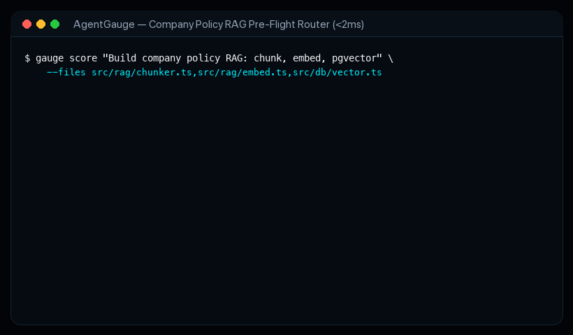

<p align="center">
  
</p>

<h1 align="center">⚡ AgentGauge (<code>agent-gauge</code>)</h1>

<p align="center">
  <strong>Stop burning Opus High on CSS edits. Stop under-powering distributed lock bugs.</strong>
</p>

**AgentGauge** is an open-source, deterministic `<15ms` Agent Skill, MCP Server, VS Code Status-Bar Extension, and Next.js 15 Telemetry Visualizer that routes coding tasks to the optimal **(Agent Execution Mode + Model Tier + Effort Level: Low / Medium / High)** and learns from real **git diff survival** outcomes.

<p align="center">
  <a href="https://agent-gauge.github.io/agent-gauge/"><strong>🚀 Launch Live Interactive Playground &amp; 3D Telemetry Demo (GitHub Pages) →</strong></a>
  &nbsp;&middot;&nbsp;
  <a href="https://github.com/Agent-Gauge/agent-gauge"><code>Agent-Gauge/agent-gauge</code></a>
</p>

<p align="center">
  <a href="https://agent-gauge.github.io/agent-gauge/">
    
  </a>
</p>
<p align="center">
  <sub><strong>Live 12s Walkthrough:</strong> Watching the <code>&lt;15ms</code> 4-dimension scorer &amp; VS Code status bar pill (<code>⚡ Gauge: Sonnet · Med (Score 48)</code>) flip from <strong>Haiku/Flash Low (Score 14)</strong> for a CSS tweak to <strong>Opus/Pro High (Score 92 · plan-first)</strong> for a distributed Redis lock &amp; Postgres billing race bug.</sub>
</p>

---

## 💡 Real-World Example: Building a Company Policy RAG Pipeline

<p align="center">
  
</p>

### What happens when you ask an agent to build a RAG system?

1. **Pre-Flight Scorer Runs in `<2ms` (Zero LLM Tokens Used):**
   - **Intent Analysis (10/35 pts):** Classifies the task as feature scaffolding.
   - **Blast Radius (4/30 pts):** Identifies target files (`src/rag/chunker.ts`, `src/rag/embed.ts`, `src/db/vector.ts`).
   - **Structural Complexity (4/20 pts):** Standard async document ingestion pipeline.
   - **Empirical Revert Risk (1/15 pts):** New files have a 0% revert rate.
   - **Score: `19/100`** $\rightarrow$ **FAST Tier**.

2. **Cost & Latency Routing:**
   - Routes to **Gemini 3.1 Flash / Claude 3.5 Haiku** (LOW effort · direct mode).
   - Routed cost: **`$0.0040`** vs **`$0.7320`** on Opus High (**99% AI quota saved**, 23.8× faster).

3. **Context Window Blast Shield Active:**
   - Enforces a strict **4,000 token prompt limit** and restricts file injection to $\le 2$ files.
   - Blocks the agent from dumping 85,000 tokens of company documents and unneeded dependencies into context.

4. **Automatic Escalation on Concurrency Bugs:**
   - When asked to *"Fix pgvector deadlock & memory leak during concurrent re-indexing"*, AgentGauge re-scores the task.
   - Intent jumps to **35/35** (concurrency triage), score jumps to **`86/100`** $\rightarrow$ **DEEP Tier**.
   - Auto-escalates to **Claude 4.6 Opus / Gemini 3.1 Pro (HIGH effort · Plan-First Mode)** with an expanded 64k token shield.

---

## Key Capabilities

- **⚡ Deterministic Pre-Flight Routing (<15ms):** Scores task intent, blast radius, structural complexity, and repo risk to select the optimal model (Flash vs Sonnet vs Opus) and effort tier with **zero LLM API cost**.
- **🛡️ Context Window Blast Shield:** Automatically calculates a recommended token & file budget (e.g. 4k tokens / 2 files on `fast` tier) to prevent amnesia and stop agents from blindly polluting context with unneeded dependency trees.
- **⚠️ Historical Regret Sentry:** Uses empirical git diff survival telemetry from `~/.agent-gauge/telemetry.db`. If an agent touches a file where past edits were reverted (>20%), it flags a high-regret warning and enforces plan/test verification.
- **🏷️ Automated GitHub Action PR Audit:** Analyzes pull request diffs and comments an instant AI complexity, quota savings, and regression risk badge directly on the PR.

---

## 5 Distribution Channels from 1 Monorepo

1. **`skills.sh` Multi-Agent Skill:**
   ```bash
   npx skills add Agent-Gauge/agent-gauge
   ```
   Powered by root [`SKILL.md`](./SKILL.md) + [`agents/router-agent.md`](./agents/router-agent.md), [`agents/calibration-agent.md`](./agents/calibration-agent.md), and [`agents/report-agent.md`](./agents/report-agent.md).

2. **GitHub Action PR AI Cost & Risk Badge (`action.yml`):**
   Add this 10-line workflow to `.github/workflows/agent-gauge.yml` in **any** repo:
   ```yaml
   name: AgentGauge PR Audit
   on: [pull_request]
   jobs:
     audit:
       runs-on: ubuntu-latest
       permissions:
         pull-requests: write
       steps:
         - uses: actions/checkout@v4
           with:
             fetch-depth: 0
         - uses: Agent-Gauge/agent-gauge@main
           with:
             github-token: ${{ secrets.GITHUB_TOKEN }}
   ```
   Or run it locally from your CLI:
   ```bash
   npx agent-gauge pr-audit --base origin/main
   ```

3. **MCP Server & CLI (`packages/mcp-server`):**
   ```bash
   npx agent-gauge score "Fix Postgres billing race condition" --files src/ledger.ts
   npx agent-gauge pr-audit
   npx agent-gauge report --out report.json
   ```
   Or add to `~/.cursor/mcp.json` / `claude_desktop_config.json`:
   ```json
   {
     "mcpServers": {
       "agent-gauge": {
         "command": "npx",
         "args": ["-y", "agent-gauge-mcp"]
       }
     }
   }
   ```

4. **VS Code / Cursor / Antigravity / Windsurf Extension (`packages/vscode-ext`):**
   Displays a live status-bar pill (`⚡ Gauge: Sonnet · Med (Score 48)`), context shield budget, and a quick-pick 4-dimension breakdown.

5. **Next.js 15 Interactive Showcase & Telemetry Visualizer (`apps/web`):**
   Configured for **GitHub Pages** as well as Vercel. Imports `@agent-gauge/core-scorer` live in the browser for real-time scoring and includes a 100% client-side `report.json` drag-and-drop dashboard.

---

## Quick Verification & Development Commands

```bash
# 1. Run Phase 1 Core Scorer unit tests (<15ms latency SLA)
node --experimental-strip-types --test packages/core-scorer/test/scorer.test.ts

# 2. Run Phase 2 MCP CLI Scorer & Generate Telemetry Report
node --experimental-strip-types packages/mcp-server/src/cli.ts score "Fix Postgres billing race condition" --files packages/core-scorer/src/scorer.ts
node --experimental-strip-types packages/mcp-server/src/cli.ts report --out apps/web/src/data/sample-report.json

# 3. Install dependencies & run the Next.js Web App locally
pnpm install
pnpm --filter @agent-gauge/web dev
```

